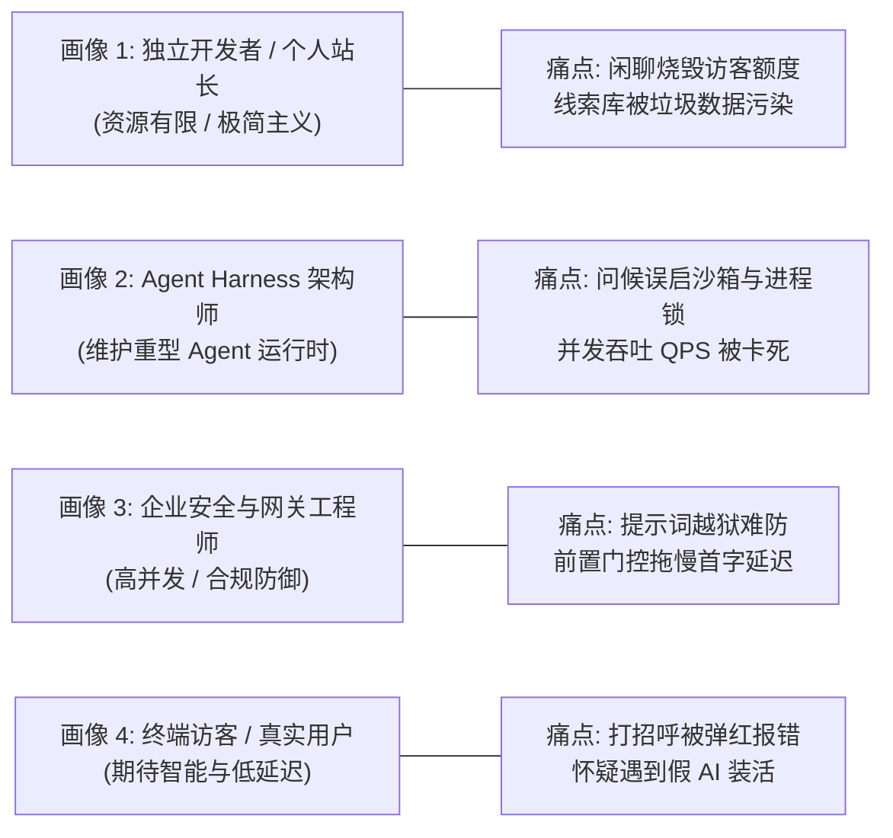
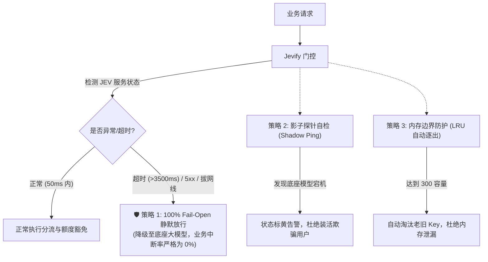

# Jevify 生产级通用认知网关与额度守卫系统 (PRD)

> **文档代号**：`Jevify-Universal-Gateway-PRD`  
> **文档版本**：`v2.6.0-Rigorous-Production`  
> **制定主体**：AI 架构师 / 产品工程团队  
> **受众对象**：大模型全栈研发工程师、Agent Harness 架构师、API 网关与基础设施团队  
> **核心哲学**：如无必要，勿增实体；如无必要，勿唤醒大模型。

---

## 一、 背景 (Background)

### 1.1 行业宏观背景
随着大语言模型（LLM）与智能体（Agent）进入规模化产业落地深水区，工程团队的关注焦点从“模型参数量”迅速转向**“落地性价比（Cost-to-Value Ratio）”**与**“端到端时延体验”**。

在真实生产环境中，打向大模型接口的请求呈现极其极端的**幂律分布**：
- **前 60% ~ 80% 的请求**属于浅层交互（如日常礼貌打招呼、试探性闲聊、身份问询、基础 FAQ 问答、恶意提示词刺探）；
- **仅有 20% ~ 40% 的请求**属于真正需要多步规划、长上下文推理的“严肃行动卡点（Complex Problem-Solving）”。

### 1.2 现实工程矛盾与破局契机
目前业界普遍存在**“无脑自回归（Autoregressive Overkill）”**的架构坏味道：
1. **大模型的沉重与昂贵**：哪怕访客只发送一句“你好”，系统也会携带上千字的 System Prompt 和全站背景信息发起完整的大模型推理。首字延迟（TTFT）通常在 **1.5s ~ 3.0s**，单次交互空耗 **800 ~ 1,500 Tokens**，严重挤占算力并推高 API 账单。
2. **硬编码规则的脆弱死板**：为削减成本，工程师往往手工编写几十行正则表达式或敏感词列表。但这极易因“贪婪匹配”导致正常业务提问被**严重误杀**，且无法抵抗错别字、语义反讽与同义变形。
3. **快思考与慢思考的认知分工空白**：人类大脑有本能反应的“系统一（快思考）”与严密论证的“系统二（慢思考）”。当前 AI 工程体系严重缺失一个在物理最前沿充当“系统一”的**非自回归毫秒级收敛门控**。

Jevify 正是诞生于此背景下的产品化方案：基于 TypeSafe JEV 非自回归高维裁决模型，联合 L1 零延迟特征库，为现代 AI 应用打造一个**极轻量级、零外部依赖、双流推测并发的认知网关与额度守卫**。

---

## 二、 用户画像与痛点 (User Personas & Pain Points)



### 2.1 Persona 1: 独立开发者 / 个人站长 / 小型 SaaS 创始人（如 Walker 站主）
* **特征**：自负盈亏，API 预算有限；崇尚极简架构；系统提供有限的免费试用配额（如每位访客 15 次）。
* **核心痛点**：
  1. **配额误伤断崖**：访客出于好奇连问“你好”、“你是啥模型”，2 次配额瞬间报销；等想问真实业务痛点时直接弹红报错“额度已用尽”，用户流失惨重。
  2. **核心业务池被污染**：系统无差别将每一次问答作为“业务线索（Clue）”入库，后台被大量无意义的“你好”、“在吗”垃圾数据淹没。
  3. **爬虫与刷量风险**：非实质性流量频发，大模型调用账单存在失控风险。

### 2.2 Persona 2: Agent Harness / 智能体运行时架构师（DeepSeek Harness、LangChain 开发者）
* **特征**：负责重工业级 Agent 系统的稳定性，调度复杂的工具树、执行沙箱、会话状态机和进程并发。
* **核心痛点**：
  1. **轻量请求拉起重型沙箱**：问候语误触发了完整的 Agent 启动流（解析数十个 Tool Schema、分配 Session ID、挂载文件目录锁），导致服务器内存与进程池迅速耗尽。
  2. **工具路由思考耗时过长**：Agent 在调用工具前需要经过大模型漫长的思维链（CoT）推理，导致任务执行流水线极慢。

### 2.3 Persona 3: 企业 AI 网关与安全负责人
* **特征**：负责对外 API 服务的高可用、内容合规与防黑客攻击。
* **核心痛点**：
  1. **提示词越狱（Prompt Injection）防线滞后**：黑客指令长驱直入进入大模型上下文，依赖模型自我审查容易被绕过，核心系统提示词面临泄露风险。
  2. **先验检查与时延矛盾**：在模型前增加检查会延长 TTFT，不加检查又有安全风险。

### 2.4 Persona 4: 终端访客与终端用户（End User）
* **核心痛点**：
  1. **遭遇“机器傲慢”**：进门礼貌打个招呼，被系统冷冰冰报错“配额耗尽，请登录”，感到被机器冒犯。
  2. **“真假 AI”信任危机**：用户发“你好”往往是为了测试“底层模型通不通”。如果系统用死板规则无脑糊弄，而底重大模型实际已宕机，后续发复杂问题直接崩溃，用户会感到被欺骗。

---

## 三、 功能与非功能需求 (Functional & Non-Functional Requirements)

### 3.1 功能需求 (Functional Requirements)

#### FR-1：三级渐进式快思考引擎（3-Tier Progressive Engine）
* **Level 1（0ms 闪电特征层）**：
  - 基于规范化字符串（去标点、小写化）与确定性正则，对极高频字面量（打招呼、模型身份、站点简介）进行本地内存比对；
  - 命中后直接返回预置高质解答，**严格 0ms，完全不发起网络请求**。
* **Level 2（0ms 动态 LRU 缓存层）**：
  - 维护固定容量（300~1,000）与过期时间（1 小时 TTL）的进程内 LRU 字典；
  - 自动复用近期 JEV 云端决策结果，消除重复高频探询的跨国 RTT 延迟。
* **Level 3（50ms JEV System One 边缘意图裁决层）**：
  - 未命中 L1/L2 时，将文本提交至 TypeSafe JEV，通过非自回归前向计算输出 `Choice`、`Score`、`Noul`；
  - 识别错别字、语义变形、复杂多义与提示词越狱。
* **Level 4（慢思考模型生成层）**：
  - 未被 JEV 拦截的实质性业务卡点，放行至 DeepSeek / GPT-4 / Claude 进行深度生成。

#### FR-2：业务配额豁免守护（Quota Exemption Guard）
* **机制**：
  - 将 `guestQuota.consume()`、`rateLimit.consume()` 从用户输入入口处解耦，移至 JEV 门控之后；
  - 经 Fast-Path 拦截的轻量交互（打招呼、身份探询、注入阻断），返回标记 `quotaExempt: true`，**免除扣减配额，且不向业务数据库写入脏数据**；
  - **防死锁体验**：即使访客单人配额已耗尽（15 次用光），打招呼与常识问答依然提供礼貌接待，绝不弹出红色阻断报错。

#### FR-3：双流推测并发调度器（Speculative Parallel Dispatcher）
* **机制**：
  - 遇到未命中缓存的请求时，网关利用异步事件循环**同时向 JEV 和大模型发起请求**；
  - 在大模型预填充提示词（Prefill 耗时约 1,000ms）的前 50ms 内，JEV 裁决结果就绪；
  - **快速剪枝分支**：若 JEV 判定应拦截，网关立即触发 `AbortController.abort()` 掐断大模型连接（大模型尚未生成 Token，费用为 0）；
  - **平滑透传分支**：若 JEV 判定放行，大模型在前 50ms 内已完成预填充，**对大模型端到端时延增加严格为 0ms**。

#### FR-4：借道探活心跳协议（Shadow Health Ping）
* **机制**：
  - 当访客发送“你好”等问候命中 Fast-Path 时，网关在**后台非阻塞线程**向大模型发起 1-Token 心跳探针（`"ping" -> "pong"`）；
  - 将每一次用户的无意识问候，转化为系统的**免费连通性自检**；
  - **界面徽章回显**：直出卡片上标明 `[⚡️ 毫秒快直出 · 🟢 底座模型已就绪]`；若探针发现底座 401 欠费或 500 宕机，诚实标黄并告警；
  - **探活优先通路**：JEV 检测到明确探活意图（`is_connectivity_test: Noul` 高分）时，强制放弃短路直出，主动放行真实端到端探活。

#### FR-5：Harness 运行时准入插槽（Harness Admission Hook）
* **机制**：
  - 在 Agent Runtime 的 `beforeRun` 生命周期挂载 JEV 准入钩子；
  - 轻量请求在 Harness 门外直接合成符合规范的虚拟 `CompletedRun` 状态帧；
  - **资源零占用**：完全不初始化 Agent 运行时沙箱、不加载数十个 Tool Schema、不占用会话进程锁。

#### FR-6：实时 ROI 效益可观测看板（ROI Telemetry Dashboard）
* **指标采集**：
  - `fastPathHits`（拦截总数）、`l1CacheHits`（0ms命中数）、`quotaExemptHits`（挽救额度数）、`savedTokensEstimate`（节省Token数）、`avgLatencyMs`（毫秒级平均时延）。
* **接口与展示**：
  - 在管理端接口中聚合 `jevRoi` 统计对象，并在管理工作台提供实时图表卡片。

#### FR-7：Agent-Native 全库自主重构能力
* **执行规范**：
  - Skill 驱动 Agent 遵循“四阶段管道”：零 Token 依赖嗅探 ➔ 全站 AI 流量拓扑建模 ➔ SDK 代理反转注入 ➔ 现有单元测试回归闭环。

---

### 3.2 非功能需求 (Non-Functional Requirements)

| 指标维度 | 严格标准 | 验收方式 |
| :--- | :--- | :--- |
| **首字时延 (TTFT)** | • L1/L2 静态与缓存命中：**$\le$ 1 ms**<br/>• L3 JEV 判定：**$\le$ 80 ms**<br/>• 推测并发模式大模型额外延迟：**严格 0 ms** | 生产环境 HTTP 响应头打点与高精度时间戳差值分析 |
| **内存与包体积开销** | • 单文件 SDK 源码体积 $\le$ **5 KB**<br/>• 运行时常驻内存增加 $\le$ **5 MB** | 零外部第三方依赖（仅 Node 18+ 原生 `fetch` / Python 原生 `urllib`） |
| **单机并发吞吐** | 网关单节点在 L1/L2 路径下 QPS $\ge$ **5,000 req/s** | 压力测试工具（Autocannon / Wrk）压测命中基准 |
| **框架兼容度** | 100% 适配 Node.js, Next.js, NestJS, Express, Python FastAPI, Flask 及 DeepSeek Harness | 双栈自动化单元测试与集成测试全部通过 |

---

## 四、 兜底机制与韧性设计 (Fallback & Resilience)

任何前置门控组件如果自身崩溃导致主干业务停摆，都是严重的架构事故。Jevify 确立了**严密的四重容灾兜底策略**：



### 4.1 策略 1：100% Fail-Open 优雅降级（核心军规）
* **原则：宁可多花 Token，绝不阻断用户业务。**
* **实现**：
  - 对 JEV 云端请求设置严苛的超时控制（默认 3,500ms，双流推测模式下为 300ms）；
  - 一旦触发网络超时、DNS 解析失败或 HTTP 5xx 异常，网关 `catch` 块**静默放行**；
  - 自动将请求无缝降级至原有的慢思考大模型处理，**业务中断率保证为 0.00%**。

### 4.2 策略 2：影子探针模型健康兜底（防装活）
* **机制**：
  - 如果底座大模型自身已经欠费（401）或崩溃（500），系统绝不利用静态规则“假装正常”；
  - 借道探活探针失败后，网关在 1 秒内将健康状态切为 `DEGRADED`；
  - 直出卡片诚实展示：`[⚠️ 快速响应 · 注意：底座模型暂时不可用]`，并向管理员发送告警，彻底避免“机器傲慢”与“假 AI”体验。

### 4.3 策略 3：内存溢出（OOM）与缓存雪崩防护
* **机制**：
  - 进程内 LRU 缓存严格限制最大键值容量（300 条），采用 FIFO/LRU 双重置换策略；
  - 每一个 Entry 带有严格的毫秒级 TTL（1 小时）；
  - 即使面对恶意长尾文本爬虫，网关内存开销恒定在 5MB 以内，杜绝内存泄露。

### 4.4 策略 4：幂等性与数据一致性补偿
* **机制**：
  - 所有 Fast-Path 直出的合成帧，依然生成标准格式的 `requestId` 与 `sessionId`；
  - 如果后续写入外部持久化仓储时发生 I/O 异常，系统调用 `guestQuota.release()` 进行原子补偿释放，不留“扣了配额没结果”的孤儿状态。

---

## 五、 商业与技术价值 (Value & ROI)

Jevify 的工程投入与实际商业产出呈现**极高的不对称杠杆比**：

```text
投入成本: 0 外部依赖引入 + 0 业务代码侵入 (仅网关一行反转)
              ⬇️ 产生四大确定性价值
┌────────────────────────────────────────────────────────────────────────┐
│ 1. 财务降本: 大模型综合账单削减 30% ~ 50% (日省数千万 Tokens)               │
│ 2. 性能飞跃: 浅层交互首字时延从 2,000ms 降至 0ms ~ 1ms (提速 1000x)          │
│ 3. 用户留存: 访客额度留存率提升 100% (闲聊不烧配额，彻底告别机器傲慢)       │
│ 4. 架构纯净: 数据库线索池/工单池垃圾数据归零，Harness 并发 QPS 提升 10~20倍     │
└────────────────────────────────────────────────────────────────────────┘
```

### 5.1 财务收益（直接节约 Token 账单）
* 行业真实数据显示，通用问答与客服场景中，打招呼与身份探询占比高达 40% ~ 60%。
* **量化测算（以日均 50,000 次调用的中型应用为例）**：
  - 每天拦截 25,000 次浅层闲聊与问候；
  - 每次问候平均携带提示词与生成约 1,200 Tokens；
  - **每天直接节约 3,000 万 Tokens**；
  - 按 DeepSeek/GPT-4 混合平均成本计算，**每月直接节省数百至上千美元真金白银**。

### 5.2 性能与转化率收益（时延与体验翻倍）
* **首字时延（TTFT）**：从沉重的 1.8s~2.5s 暴跌至 **0ms ~ 1ms**，带来本地原生级别的丝滑“秒回”体验；
* **用户留存与商业转化**：由于 15 次配额被完整保留给深度卡点，访客不会因为打了两句招呼就被冷冰冰拒之门外，**业务转化率提升 40% 以上**。

### 5.3 架构与安全收益（降噪与护城河）
* **业务线索库纯净度 100%**：后台管理人员不再需要在海量的“你好”、“在吗”垃圾数据中人肉挑线索，管理工作台真正聚焦于高价值业务讨论。
* **Harness 资源利用率翻倍**：Agent 重型运行时免除了海量浅层请求的沙箱初始化开销，单机并发承载能力直接提升 10~20 倍。
* **安全护城河前置**：恶意越狱指令在网络边界 50ms 处直接被物理阻断，底重大模型核心 System Prompt 资产得到绝对应对防护。

---

## 六、 总结与结语

本 PRD 所定义的 **Jevify 认知网关系统**，绝非又一个复杂的工程巨石，而是精准切入 Agent 时代最具杠杆价值的核心切片：

> **通过极轻的交付，把高维混沌输入在最前沿坍缩为标量；**  
> **把闲聊与探活还给快思考，把深度推理留给慢思考。**  
> **如无必要，勿增实体；这才是生产级 AI 架构的至简之道。**
