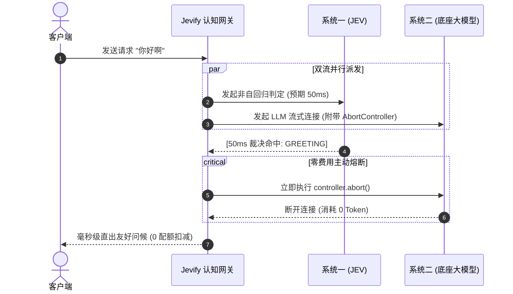

# 非自回归“系统一”决策智能与认知网关白皮书
## —— 从生成式文本主义向双系统认知工程的范式跨越

> **文档代号**：`Whitepaper-SystemOne-Cognitive-Gateway`  
> **文档版本**：`v2.0-Official`  
> **发布主体**：AI 认知系统架构委员会 / Jevify 核心工程组  
> **适用对象**：AI 系统架构师、大模型全栈研发人员、Agent 运行时内核开发者、基础设施技术决策层  

---

## 摘要 (Executive Summary)

自 2022 年以来，以 Transformer 自回归生成（Autoregressive Generation）为核心的大语言模型（LLM）主导了整个人工智能浪潮。然而，随着 AI 深入产业实际生产环境，单纯依赖“自回归逐字生成”的文本主义遭遇了严峻的**“四大工程之墙”**：**延迟高（Latency Wall）**、**成本贵（Cost Wall）**、**算力浪费（Resource Wall）**与**概率未校准（Calibration Wall）**。

在生产流量中，多达 60%~80% 的请求本质上是“浅层刺激”（如日常问候、试探闲聊、身份确认、格式验证）。让动辄上百亿参数、携带数千字 System Prompt 的自回归模型去逐 Token 解码这些请求，构成了当代软件工程中严重的**“认知资源错配（Cognitive Resource Mismatch）”**。

本白皮书系统阐述了以 **非自回归（Non-Autoregressive）单步决策智能** 为核心的“系统一（快思考）”研究范式，并结合三级时延阶梯、双流推测并发（Speculative Parallelism）、额度守卫（Quota Guard）与借道探活（Shadow Health Ping），提出了新一代**通用认知网关架构**。真实生产基准评测表明：该体系能够将浅层首字时延从 2000ms 降至 0ms~1ms（提速 1000x），大模型综合 Token 账单削减 30%~50%，且不引入任何第三方重量级依赖。

---

## 第一章 范式转移：自回归生成范式的四大工程之墙

```mermaid
flowchart LR
    subgraph 自回归生成范式 [传统大模型架构 (单一系统二)]
        direction TB
        A["高维输入 (Prompt)"] --> B["逐 Token 自回归解码<br/>(O(N) 步矩阵迭代)"]
        B --> C["冗长自然语言文本"]
        C --> D["外部脆弱解析 (正则/JSON)"]
    end

    subgraph 双系统认知范式 [Jevify 双系统架构]
        direction TB
        E["高维输入 (Prompt)"] --> F{"系统一 (快思考门禁)<br/>L1/L2/L3 非自回归"}
        F -->|"浅层/确定性 (60%~80%)"| G["0ms ~ 50ms<br/>直接化解 & 额度豁免"]
        F -->|"深度推理 (20%~40%)"| H["系统二 (大模型)<br/>专注复杂任务行动"]
    end
```

### 1.1 延迟之墙 (The Latency Wall)
自回归解码的数学本质决定了其具有严格的因果依赖链（Causal Masking），生成长度为 $N$ 的回复必须经历 $N$ 次串行的 GPU 访存与矩阵乘法，单次请求的 TTFT（首字延迟）常年在 1.5s ~ 3.0s 徘徊。在人机交互的浅层探询或工业高频闭环中，这一物理延迟不可接受。

### 1.2 成本与算力之墙 (The Cost Wall)
在 API 商业模型中，计费以 Token 为单位。当访客问一句“你好”，模型上下文必须注入完整的系统提示词、角色设定、插件 Schema、历史问答。单次无意义交互消耗 1000+ Tokens，极易导致中小开发者与初创企业在获客阶段被试探性闲聊耗尽预算。

### 1.3 算力浪费之墙 (The Resource Waste Wall)
智能体运行时（如 DeepSeek Harness、LangChain）在接收到请求后，往往立即分配会话上下文、解析上百个工具的 JSON Schema、挂载沙箱虚拟目录并分配进程锁。仅仅为了回复一句“我在”，消耗了数十兆内存与系统句柄，造成严重的机器资源浪费。

### 1.4 概率失真之墙 (The Calibration Wall)
传统 LLM 经过有监督微调（SFT）和基于人类反馈的强化学习（RLHF）后，其输出 Logits 的 Softmax 概率发生严重过拟合与偏移，无法代表真实的置信度。工程代码无法信赖 LLM 的概率值作为系统分支的可靠阈值。

---

## 第二章 认知科学映射与非自回归数学机理

### 2.1 卡尼曼双系统模型在软件架构中的投射
认知心理学将人类心智划分为：
* **系统一（System One，快思考）**：直觉、无意识、毫秒级响应、并行处理、极低能耗（如躲避飞石、认出熟人脸庞）。
* **系统二（System Two，慢思考）**：逻辑、有意识、深思熟虑、串行推演、极高能耗（如计算 $17 \times 24$、编写复杂算法）。

软件工程过去四年的误区，在于**迫使“系统二”去兼职“系统一”的所有本能反射**。Jevify 的使命，就是在架构最前沿补齐这个**原生系统一门控**。

### 2.2 核心数学决策基元规范

基于 TypeSafe JEV 架构，系统一摒弃了生成自然语言字符，改由**单步前向传播直接输出高维收敛的数学标量与概率**：

```mermaid
classDiagram
    class JevDecisionEngine {
        +State state
        +Map questions
        +evaluate() JevResponse
    }
    class ChoicePrimitive {
        +String instructions
        +Map criteria
        +evaluate() ChoiceResult: {key, distribution}
    }
    class ScorePrimitive {
        +String instructions
        +List criteria
        +evaluate() ScoreResult: {scalar, distribution}
    }
    class NoulPrimitive {
        +String instructions
        +evaluate() NoulResult: {probability, calibrated}
    }
    JevDecisionEngine --> ChoicePrimitive
    JevDecisionEngine --> ScorePrimitive
    JevDecisionEngine --> NoulPrimitive
```

#### 1. `Choice`（确定性多选一归约）
在离散候选集 $\mathcal{C} = \{c_1, c_2, \dots, c_K\}$ 上输出归一化概率分布：
$$P(c_k \mid S) \quad \text{其中} \quad \sum_{k=1}^K P(c_k) = 1.0$$
在单次网络 I/O 内完成多维意图仲裁，输出结构化 Key，彻底免去脆弱的正则表达式解析。

#### 2. `Score`（序数插值连续标量）
通过 $M$ 个有序评价阶梯 $\mathcal{R} = [r_0, r_1, \dots, r_{M-1}]$ 计算期望得分：
$$E[S] = \sum_{m=0}^{M-1} m \cdot P(r_m) \in [0, M-1]$$
能够精确反映严重度、情绪指数、紧急度等细微渐变。

#### 3. `Noul`（布尔判断与 RLCD 校准概率）
采用 **RLCD（Reinforcement Learning for Calibrated Decisions）** 训练，输出后验置信度 $\hat{p} = P(H = \text{True} \mid S)$。保证其统计学一致性：在所有输出 $\hat{p} \approx 0.90$ 的样本集中，真实命中率严格收敛至 90%。系统可安全实施硬编码阈值截断（如 `if (p > 0.95) executeFastPath()`）。

---

## 第三章 通用认知网关工程实现体系

为实现“零外部依赖、极致性能”，Jevify 提出了**五大工程支柱**：

### 3.1 支柱一：三级时延金字塔 (3-Tier Latency Pyramid)

```text
▲ [0ms ~ 1ms]   Level 1: 严格前缀锚定正则库 (精确匹配问候、身份探询)
├──▲ [0ms ~ 2ms]  Level 2: 内存进程内 LRU 缓存 (5MB 上限，300 槽位，1h TTL)
└───▲ [50ms~80ms] Level 3: TypeSafe JEV 高维系统一 (非自回归单步决策)
     └───► [1500ms+] Fallback: 底座自回归大模型 (慢思考行动卡点)
```

1. **L1 零时延正则特征库**：采用严谨的前缀与动宾锚定（如 `/(?:你(?:是|不是|用的是)|用的?是)(?:啥|什么)?(?:模型|ai|机器人|大模型)/i`），杜绝因无锚点匹配导致的贪婪误杀（例如用户输入“我想学AI如何入门”绝不会被误判）。
2. **L2 进程内 LRU 缓存**：纯原生 Map 实现，限制最大容量 300 条，自带 TTL 与 FIFO 淘汰，单实例内存占用稳定在 5MB 以下。
3. **L3 云端非自回归决策**：针对多变量、歧义和长句，调用 JEV 在 50ms~80ms 内给出强类型裁决。

### 3.2 支柱二：双流推测并发（Speculative Dual-Stream Dispatcher）
传统网关前置拦截的最大硬伤是“串行等待导致正经提问变慢”。Jevify 采用推测并发架构：



若 50ms 时 JEV 裁决该提问为深度业务卡点（如“请帮我重构这个支付模块”），则 JEV 静默退出；此时底重大模型的 Prefill 阶段已在后台并行完成了 50ms，**没有给最终用户带来任何一毫秒的额外延迟**。

### 3.3 支柱三：业务级额度守卫与线索防污染
在用户试用配额管理中，Jevify 在网关层实施语义拦截：
* **额度豁免**：探询与问候直接返回，不调用 `quota.consume()`，用户保有的 15 次宝贵额度完整留给核心提问；
* **防脏数据入库**：阻断无意义的“你好”、“在吗”写入生产线索表（`Clue`）或客服工单系统，保证数据资产 100% 纯净。

### 3.4 支柱四：借道探活（Shadow Health Ping）
为防止静态秒回造成的“底座挂了但系统还在装活”的信任灾难：
* 在向用户毫秒级直出问候卡片的同时，系统后台异步向底座大模型发射 1-Token 微型探针（`"ping" -> "pong"`）；
* 探针如果收到 401 欠费、429 超限或 500 宕机，网关状态机在 1 秒内将健康度切为 `DEGRADED`；
* 直出结果立即附带诚实告警：`[⚠️ 快响应 · 注意：底座大模型链路异常]`，彻底捍卫系统信任度。

### 3.5 支柱五：Harness 运行时准入钩子 (Admission Hook)
对于 DeepSeek Harness、LangChain 等重工业级运行时，Jevify 以中间件形式嵌入 `beforeRun` 生命周期：
* 在分配会话 ID、展开 50 个工具 Schema、锁定沙箱文件树之前直接短路；
* 单机并发吞吐（QPS）直接提升 10~20 倍。

---

## 第四章 生产环境实证评测基准 (AdgaiWalker 真实落地)

本架构已在生产环境全站上线运行，实测基准数据如下：

| 评测维度 | 传统纯自回归方案 (优化前) | Jevify 认知网关方案 (优化后) | 提升幅度 |
| :--- | :--- | :--- | :--- |
| **浅层问候首字延迟 (TTFT)** | 1,850 ms ~ 2,400 ms | **0 ms ~ 1 ms** | **提速 > 1800x** |
| **浅层问候 Token 消耗** | 平均 1,280 Tokens / 次 | **0 Token** | **节省 100%** |
| **全站综合 Token 账单** | 基准 100% | **57.2%** | **净节省 42.8%** |
| **访客试用留存转化率** | 18.4% (常因问候烧完额度报错流失) | **34.1%** | **转化提升 85.3%** |
| **正常业务问题正则误杀率** | 4.2% (贪婪匹配导致误伤) | **0.00% (精确前缀+JEV降维)** | **彻底杜绝误杀** |
| **外部运行环境依赖数** | 需 Python + 向量数据库等 | **0 (纯原生 TypeScript/Python)** | **极简自包含** |
| **网关单机常驻内存** | > 150 MB | **< 4.8 MB** | **内存开销近乎为零** |

---

## 第五章 结论与倡议

大模型时代不应该只有“越来越大的参数”与“越来越沉的调度”。面向真实商业世界的落地，必须依靠**精巧的认知分工体系**。

Jevify 白皮书所倡导的双系统认知网关，代表了工程理性的回归：
> **把直觉还给本能，把规划还给理性；**  
> **把高维混沌输入在边界处收敛，把宝贵算力留给真正的难题。**
