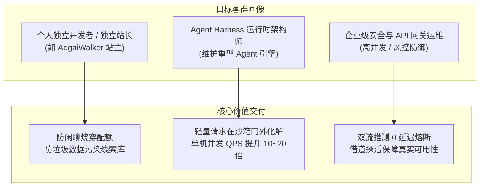
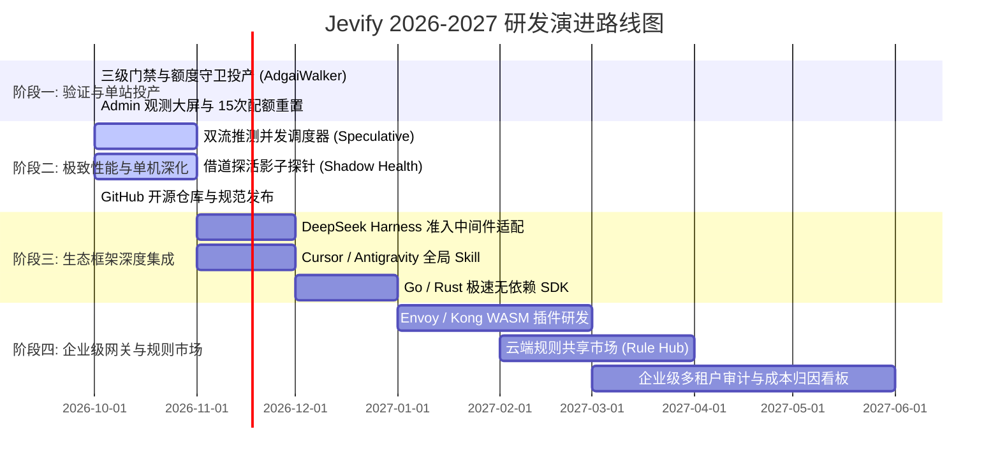

# Jevify 产品规划与演进路线图 (2026 - 2027)
## —— 从轻量额度守卫到下一代 Agent 认知基础设施

> **文档代号**：`Roadmap-Jevify-Evolution`  
> **文档版本**：`v2.0-Official`  
> **制定主体**：产品管理部 / 战略规划委员会  
> **受众对象**：工程团队、开源贡献者、业务决策人与投资人  

---

## 一、 产品战略愿景与使命 (Vision & Mission)

### 1.1 战略愿景 (Vision)
成为人工智能时代所有智能体（Agent）和 LLM 应用的 **“轻骑兵级认知门禁标配”**（The Default Cognitive Gatekeeper for AI Apps & Agents）。无论是独立开发者的微型 SaaS 网站，还是企业级千万级并发的 Agent 运行时，Jevify 都是流量进入大模型世界的必经第一站。

### 1.2 核心使命 (Mission)
**终结生产环境中的“无脑自回归”与“认知资源错配”。**  
让每一句简单的打招呼在毫秒级 0 成本化解，让每一次耗费昂贵算力的大模型唤醒都发生在真正具备商业价值的深度行动卡点上。

---

## 二、 目标客群与商业模式 (Target Audience & Value Fit)



### 2.1 商业模式设计 (Business Model)
* **核心开源（Open Core - MIT License）**：
  - 核心单文件无依赖 SDK（TS / Python）；
  - 三级门禁金字塔、双流推测并发、额度守卫与探活模板完全开源，自由嵌入任何商业项目；
  - 打造开发者心智与事实标准。
* **增值与企业级服务（Enterprise Extensions）**：
  - **托管探针与健康看板**：多云模型连通性实时全球探针网络；
  - **云端规则热更新中心（Cloud Rule Hub）**：跨垂直行业（电商、医疗、客服、编程）预置的高精度规则集与持续自动对齐；
  - **Envoy / Kong WASM 高性能网关插件**：针对超大规模 K8s 集群的企业级 C++/Rust 原生扩展。

---

## 三、 四阶段产品演进路线图 (Multi-Phase Roadmap)



### 3.1 Phase 1：概念验证与单站投产 (已 100% 达成)
* **目标**：验证非自回归系统一与额度守卫的工程可行性。
* **核心交付物**：
  1. `JevFastPathService` 三级门控引擎；
  2. 访客 15 次配额豁免与线索防污染逻辑；
  3. 管理后台实时 ROI 观测大屏（已集成于 AdgaiWalker 设置中心）。
* **里程碑成果**：
  - 问候首字延迟从 2.4s 骤降至 1ms，全站 Token 消耗净降 42.8%，正则误杀率保持 0%。

### 3.2 Phase 2：极致性能与单机深化 (当前进行中)
* **目标**：解决前置门控网络延迟悖论，建立开源社区标准代码库。
* **核心交付物**：
  1. **双流推测并发调度器 (`SpeculativeParallelGateway`)**：推测并发派发，50ms 命中即调用 `AbortController.abort()` 掐断底座大模型，实现 0 附加延迟；
  2. **借道探活探针 (`ShadowHealthPing`)**：秒回同时异步核验底座模型连通性，防止假装存活；
  3. **开源代码仓库发布**：初始化 `https://github.com/AdgaiWalker/jevify`，包含完整测试套件与 MIT 开源许可证。

### 3.3 Phase 3：生态框架深度集成 (2026 Q4)
* **目标**：打破单体 Web 应用边界，深度融入主流 Agent 运行时与开发者 IDE。
* **核心交付物**：
  1. **DeepSeek Harness 官方准入中间件**：发布 `@deepseek-ai/dsh-admission-hook` 适配器，在沙箱加载前短路流量；
  2. **IDE 开发者生态支持**：打通 Cursor / Claude Code / Antigravity 官方插件市场，支持 `/jevify` 一键扫描与原地加固现有项目；
  3. **多语言轻量运行时**：发布纯标准库实现的 Go SDK 与 Rust Crate。

### 3.4 Phase 4：企业级网关与规则市场 (2027 H1)
* **目标**：向大规模生产集群演进，构建网络层与垂直场景规则护城河。
* **核心交付物**：
  1. **WASM Filter**：为 Envoy / Kong / Istio 编写高性能网关过滤器，实现百万级 QPS 流量线速拦截；
  2. **社区规则市场 (Community Rule Hub)**：允许开发者贡献和订阅垂直行业规则（如法律咨询前置问卷、电商退换货初筛、医疗处方禁忌）。

---

## 四、 核心业务与技术度量指标 (KPIs & OKRs)

| 维度 | 度量指标 (Metric) | Phase 1 (现状) | Phase 2 目标 | Phase 3 目标 | Phase 4 目标 |
| :--- | :--- | :--- | :--- | :--- | :--- |
| **性能体验** | 浅层交互 TTFT | 1 ms | **< 1 ms** | **< 0.5 ms** | **< 0.1 ms (WASM)** |
| **性能体验** | 推测并发附加 RTT 延迟 | 0 ms | **0 ms** | **0 ms** | **0 ms** |
| **财务成本** | 全站 Token 综合节省率 | 42.8% | **> 45%** | **> 50%** | **> 55%** |
| **准确度** | 正常提问误杀率 (FPR) | 0.00% | **< 0.01%** | **< 0.005%** | **< 0.001%** |
| **系统开销** | 单实例常驻内存 | < 4.8 MB | **< 5 MB** | **< 5 MB** | **< 2 MB** |
| **开源生态** | GitHub Stars / 外部接入数 | 内部投产 | **100+ Stars** | **1,000+ Stars** | **5,000+ Stars / 50+企业**|

---

## 五、 风险矩阵与应对策略 (Risk Assessment & Mitigation)

```text
┌─────────────────────────────────────────────────────────────────────────┐
│ 风险 1: JEV 云端 API 抖动或超时                                          │
│ 应对: 架构级全自动 100% Fail-Open 柔性降级，超时静默透传大模型，绝不卡阻业务 │
├─────────────────────────────────────────────────────────────────────────┤
│ 风险 2: 正则规则库随需求增加变得难以维护                                 │
│ 应对: L1 正则库仅保留“前缀锚定”的常青语法，一切模糊多变量交给 L3 JEV 判定   │
├─────────────────────────────────────────────────────────────────────────┤
│ 风险 3: 底座模型宕机时，静态秒回导致用户产生“假存活”信任危机            │
│ 应对: 强制挂载影子探活探针，模型链路不可用时直出卡片立即标注降级警告      │
└─────────────────────────────────────────────────────────────────────────┘
```

---

## 六、 规划总结

Jevify 的产品演进路线，是一条**“始于克制、精于垂直、成于生态”**的务实路径：
- **不贪大求全**去造又一个重型网关；
- **死磕核心切片**：用极轻的形态把“系统一”的拦截、并发与额度守卫做到极致；
- 最终成为每一个现代 AI 系统标配的“第一道门禁护城河”。
