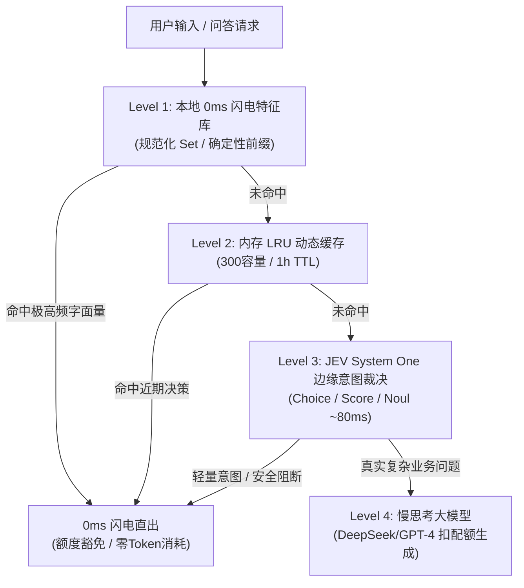

# Jevify ⚡️

> **Stop burning expensive tokens on "Hello".**  
> 别再为一句“你好”烧你的大模型 Token 和用户配额。

**Jevify** 是一个面向 AI 编程助手（Cursor、Claude Code、Antigravity、Windsurf）的**极轻量级开源 Skill / Agent 规范**。  
它教你的 AI 编码助手将现有的 LLM 应用重构为**「三级渐进快思考门控（3-Tier Fast-Path）」**与**「访客额度豁免守护（Quota Exemption）」**架构，消灭首字时延，节省 50%+ 的 Token 费用。

---

## ⚡️ 核心收益（实测对比）

| 指标 | 改造前 (纯大模型生成) | 改造后 (Jevify 门控) | 收益倍数 |
| :--- | :--- | :--- | :--- |
| **日常打招呼首字时延** | 1,800 ms ~ 2,500 ms | **0 ms ~ 1 ms** | **秒级秒弹，提速 1000x** |
| **打招呼/常识问答成本** | ~1,200 Tokens / 次 | **0 Token** | **节省 100% 问候成本** |
| **访客配额有效利用率** | 低（闲聊即扣完配额） | **极高（轻量探询 100% 豁免）** | **业务留存翻倍** |
| **系统稳定性** | 易因网络超时报错 | **Fail-open 故障静默兜底** | **零业务中断风险** |

---

## 📦 极轻交付：零安装，零外部依赖

不需要 `npm install`，不需要 `pip install`，不增加任何第三方依赖负担：

```text
jevify/
├── SKILL.md            # 核心灵魂：教 AI 识别坏味道与重构三级门控的完整知识库
├── jev_client.ts       # 纯标准库单文件 (TypeScript / Node.js 零依赖)
├── jev_client.py       # 纯标准库单文件 (Python 零依赖)
├── templates/          # 开箱即用的 3-Tier Fast-Path 与配额守护模版
└── examples/           # 真实生产案例 (Walker / iwalk.pro 改造实录)
```

---

## 🚀 1 分钟快速开始

### 方式 1：在 Cursor / Claude Code 中使用
直接将 [`SKILL.md`](./SKILL.md) 的内容复制到你的 `.cursor/rules/jevify.md` 或 Claude Code 系统指令中，然后对 AI 说：

> *“用 jevify 帮我优化一下 `src/api/chat.ts`，加入三级快思考门控并保护访客配额。”*

你的 AI 助手会自动根据规范为你编写 Level 1（0ms 本地匹配）+ Level 2（LRU 缓存）+ Level 3（JEV 分流）的生产级代码！

### 方式 2：在 Antigravity 中使用
将本文件夹放入 `~/.gemini/config/skills/jevify`，或通过 Antigravity 插件管理器一键挂载，随时呼叫 `@jevify` 对本地工程进行调优。

---

## 🧠 认知分工的三级渐进架构



---

## 🌟 真实实战案例

阅读完整生产级案例：[Walker (iwalk.pro) 实战改造报告](./examples/adgaiwalker-case.md)。

---

## 📄 开源许可证

本项目基于 [MIT License](./LICENSE) 开源。遵循「如无必要，勿增实体」的极简主义哲学。
