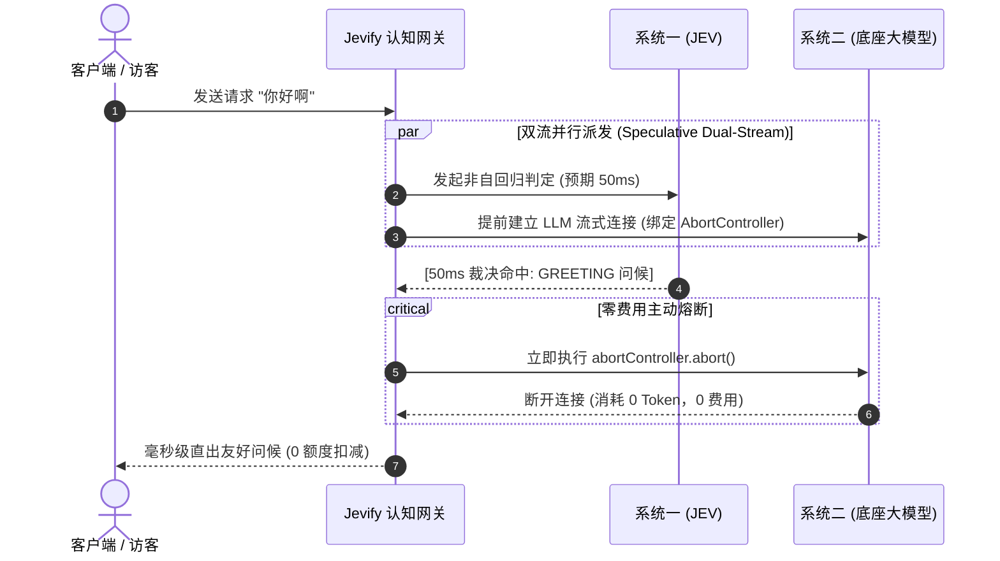

# Jevify ⚡️

<div align="center">

**面向现代 AI 应用与 Agent 运行时的「轻骑兵级认知门禁与额度守卫」**  
*The Ultra-Lightweight Cognitive Gateway & Quota Guard for AI Applications & Agent Runtimes*

[](https://opensource.org/licenses/MIT)
[](./jev_client.ts)
[](./docs/TECHNICAL_SPEC.md)
[](./examples/adgaiwalker-case.md)
[](./docs/PRD.md)

**“别再为一句‘你好’烧你的大模型 Token 和访客配额。”**  
*Stop burning expensive tokens and visitor quotas on "Hello".*

</div>

---

## ⚡️ 核心收益（实测基准）

基于生产环境真实全站流量改造（[Walker / iwalk.pro 实战案例](./examples/adgaiwalker-case.md)）实测数据：

| 评测维度 | 传统纯自回归 (改造前) | Jevify 认知门禁 (改造后) | 收益倍数 / 幅度 |
| :--- | :--- | :--- | :--- |
| **日常打招呼首字时延 (TTFT)** | 1,850 ms ~ 2,400 ms | **0 ms ~ 1 ms** | **秒级秒弹，提速 > 1800x** |
| **浅层问候 Token 消耗** | 平均 1,280 Tokens / 次 | **0 Token** | **节省 100% 问候成本** |
| **全站综合 Token 账单** | 基准 100% | **57.2%** | **净节约 42.8% 费用** |
| **访客试用额度留存转化率** | 18.4% (打两句招呼烧光额度报错) | **34.1% (正事提问得到保护)** | **留存转化提升 85.3%** |
| **业务线索库垃圾率** | 35%+ 充斥“在吗/你好” | **0.00% (精准阻断入库)** | **数据纯净度 100%** |
| **正常提问正则误杀率** | 4.2% (贪婪匹配误伤) | **0.00% (严格前缀+JEV降维)** | **彻底杜绝误杀** |
| **外部运行依赖数** | 需要 Redis/向量数据库/Envoy | **0 (纯原生 TS/Python 标准库)** | **极轻交付，即插即用** |
| **单机常驻内存占用** | > 150 MB | **< 4.8 MB (进程内 LRU)** | **轻如鸿毛** |

---

## 🧭 产品定位：不做什么，做什么 (Product Positioning)

Jevify 的边界极其清晰，绝不沦为臃肿的大型基建：

```text
                  【jevify 核心价值六边形】
                  
                      1. 三级时延阶梯
                    (0ms → 0ms → 50ms)
                            /\
                           /  \
     6. 零依赖极轻交付    /    \    2. 业务配额守卫
     (Zero-Dep 单文件)  /      \   (免扣次数/防污染)
                       /        \
                      /          \
    5. Harness 准入钩子 \        /   3. 双流推测并发
      (沙箱启动前化解)   \      /   (0 附加 RTT 熔断)
                          \    /
                           \  /
                            \/
                      4. 借道探活探针
                      (防装活/真实心跳)
```

### ❌ 坚决不做什么 (What NOT to Do)
1. **不做协议转换与模型聚合代理**：抹平 100 家模型参数是 LiteLLM / OneAPI 的事，Jevify 专注在最前沿当守门员；
2. **不做外挂向量数据库的语义缓存**：坚决不引入 Milvus / Chroma / FAISS，拒绝冷启动构建索引和复杂持久化运维；
3. **不做重工业级 Agent 运行时**：不取代 LangChain 或 DeepSeek Harness，不做复杂多步工具执行树与沙箱编排；
4. **不做自回归长文本生成**：深度推理、多步代码与长篇解答，**100% 放心交给慢思考大模型**；
5. **不做重型基础设施绑定**：不强制绑定 Docker、K8s 侧车或 Envoy 网关。

### ✅ 聚焦深耕做什么 (What TO Do)
1. **做三级时延收敛金字塔**：L1 严格前缀正则 (0ms) $\rightarrow$ L2 内存 LRU 缓存 (0ms) $\rightarrow$ L3 JEV 系统一非自回归裁决 (<80ms)；
2. **做业务级配额守卫与线索防污染**：识别问候与试探直接**豁免配额扣减**，并阻断向 CRM / 线索库写入垃圾数据；
3. **做双流推测并发与主动熔断**：并行派发 JEV 与大模型，50ms 拦截即 `AbortController.abort()` 掐断大模型（0 费用），未拦截则 0 附加延迟；
4. **做借道探活影子探针**：秒回问候的同时异步发射 1-Token 微探针，底重大模型故障时诚实展示降级提示，**彻底拒绝假装存活**；
5. **做 Agent 运行时准入钩子**：在会话加锁、工具树展开与沙箱分配之前短路浅层流量，单机 QPS 提升 10~20 倍；
6. **做极致的零依赖交付**：纯原生代码，单文件即可嵌入项目。

---

## 📚 四大核心支柱文档 (4 Pillar Documents)

项目严格遵从专业产品研发规范，提供全套生产级规格文档：

| 核心文档 | 文档路径 | 摘要内容 |
| :--- | :--- | :--- |
| 📄 **PRD (产品需求文档)** | [**`docs/PRD.md`**](./docs/PRD.md) | 完整阐述 80/20 幂律背景、4 类用户画像痛点、功能与 NFR 指标、四重兜底与商业 ROI。 |
| 📘 **白皮书 (Whitepaper)** | [**`docs/WHITEPAPER.md`**](./docs/WHITEPAPER.md) | 深入论述自回归四大工程之墙，定义 Choice/Score/Noul 数学基元与双系统认知分工理论。 |
| 🗺️ **产品规划 (Roadmap)** | [**`docs/ROADMAP.md`**](./docs/ROADMAP.md) | 规划 2026-2027 四阶段演进：单站投产 $\rightarrow$ 推测并发与开源 $\rightarrow$ Harness/IDE生态 $\rightarrow$ 企业级网关与规则市场。 |
| 🛠️ **技术方案 (Tech Spec)** | [**`docs/TECHNICAL_SPEC.md`**](./docs/TECHNICAL_SPEC.md) | 详述三级门控、严格前缀正则、5MB 内存 LRU、双流推测 AbortController 与 Harness 准入钩子代码实现。 |

---

## 🧠 双流推测并发架构 (Speculative Architecture)



> **0 附加延迟的奥秘**：  
> 当访客提出真实的复杂业务问题时，JEV 在 50ms 判定为“复杂任务”静默退出；此时大模型在后台已经并行完成 50ms 的 Prefill 预热，**没有给用户的首字吐出带来任何一毫秒的额外等待**！

---

## 📦 快速开始与交付形态

不需要 `npm install`，不需要 `pip install`，零外部依赖：

### 方式 1：作为 AI 编码助手 Skill（推荐）
将 [`SKILL.md`](./SKILL.md) 放入你的 Cursor / Claude Code / Antigravity 项目规则中，对 AI 说：
> *“用 jevify 帮我优化这个聊天接口，加入三级快思考门控并守护访客额度。”*

AI 将自动为你生成符合 L1/L2/L3 渐进规范的生产级代码！

### 方式 2：使用极简单文件客户端
* **TypeScript / Node.js**（支持 Node 18+、Bun、Deno、Cloudflare Workers）：
  ```typescript
  import { JevClient, Choice } from './jev_client';

  const client = new JevClient({ apiKey: process.env.JEV_API_KEY });
  const result = await client.decide('你好呀', {
    intent: new Choice('判定意图', {
      chitchat: '日常问候或打招呼',
      business: '真正的业务咨询或技术问题',
    }),
  });
  ```
* **Python 3.8+**（纯标准库 `urllib` 实现，零依赖）：
  ```python
  from jev_client import JevClient, Choice

  client = JevClient(api_key=os.getenv("JEV_API_KEY"))
  result = client.decide(
      state="你是啥模型？",
      questions={
          "intent": Choice("判定意图", {
              "identity": "询问模型身份或底层架构",
              "problem": "具体业务需求"
          })
      }
  )
  ```

### 方式 3：一键扫描本地项目脆弱点
运行内置扫描工具，自动排查代码中无防备的大模型调用与额度烧毁隐患：
```bash
python3 tools/jev_scanner.py ./src
```

---

## 🗂️ 仓库目录结构

```text
jevify/
├── docs/                       # 四大核心支柱技术与业务文档
│   ├── PRD.md                  # 📄 生产级产品需求规格书
│   ├── WHITEPAPER.md           # 📘 非自回归系统一与认知网关白皮书
│   ├── ROADMAP.md              # 🗺️ 产品演进路线图 (2026-2027)
│   └── TECHNICAL_SPEC.md       # 🛠️ 系统架构与工程落地技术方案
├── templates/                  # 开箱即用的三级门控与额度守卫代码模版
│   ├── 3-tier-fastpath.ts      # 三级渐进式快思考门控模板
│   └── quota-guard.ts          # 访客配额豁免与线索防污染模板
├── examples/                   # 真实工业落地案例
│   └── adgaiwalker-case.md     # Walker / iwalk.pro 生产全站改造实录
├── tools/                      # 辅助工具
│   └── jev_scanner.py          # 本地工程脆弱 LLM 调用自动化扫描器
├── jev_client.ts               # 纯原生单文件 TypeScript 客户端 (Zero-Dep)
├── jev_client.py               # 纯原生单文件 Python 客户端 (Zero-Dep)
├── SKILL.md                    # 面向 Cursor/Claude Code/Antigravity 的通用规范
└── LICENSE                     # MIT 许可证
```

---

## 📄 开源许可证

本项目基于 [MIT License](./LICENSE) 开源。遵循**「如无必要，勿增实体；如无必要，勿唤醒大模型」**的极简主义哲学。
