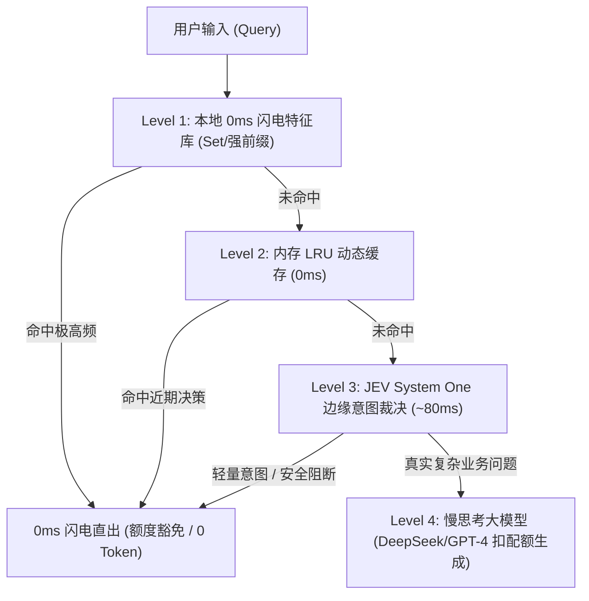

# Jevify: AI 时代的快思考分流与额度守护 Skill

> **核心哲学**：如无必要，勿增实体。别再让大模型为一句“你好”烧你的 Token 和用户配额。

本 Skill 教你（AI Coding Agent）如何将任意大语言模型（LLM）应用，快速重构为**「认知分工的生产级三级渐进门控系统」**。

---

## 什么时候激活本 Skill？
当用户提到以下需求时：
- “帮我优化这个 AI 接口的时延/速度”
- “我的大模型账单/Token 消耗太高了”
- “访客打了两句招呼就把配额用光了，怎么做额度豁免？”
- “有很多打招呼、闲聊、探问身份的请求，不需要走大模型慢思考”
- “对当前项目进行 JEV 赋能 / Jevify 改造”

---

## 核心重构三原则

### 1. 动静互补原则（避免正则误杀与全盘云端时延）
- **静态强特征（L1 0ms）**：纯字面量、高频确定性问候（`你好`、`在吗`、`hi`）、系统身份探测。坚决留在本地 Set/正则，**绝对不走网络**。
- **动态模糊语义（L3 JEV）**：涉及错别字、意图泛化、歧义推断、多分类路由的场景，坚决交给 JEV 非自回归高维裁决，**禁止在代码里写宽泛贪婪正则**。

### 2. 额度豁免原则（Quota Exemption）
- 业务系统中的 `consumeQuota()`、`use_budget()`、`rateLimit.consume()` **严禁**直接暴露在用户输入入口。
- 必须前置通过 JEV / L1 过滤：轻量探询、礼貌打招呼、系统介绍、安全注入探测直接直出，**豁免配额扣减**，保持核心业务数据池（如线索库、工单库）纯净。

### 3. 三级渐进架构（3-Tier Progressive Gating）

---

## 落地指导步骤（Agent 执行指南）

### 步骤 1：引入零依赖客户端
根据项目技术栈，将单文件客户端复制到用户工程：
- TypeScript / Node.js 项目：复制 [`jev_client.ts`](./jev_client.ts) 至 `src/lib/jev_client.ts`
- Python 项目：复制 [`jev_client.py`](./jev_client.py) 至 `lib/jev_client.py`

### 步骤 2：识别坏味道（Smell Inspection）
检查目标代码是否存在以下问题：
1. **Unguarded Quota**：在业务逻辑开始处无差别扣减访客配额；
2. **LLM Overkill**：在流式接口或首屏对话处，直接让大模型慢推理来回一两句常识问候；
3. **Fragile Regex**：写了太宽泛的正则导致正常提问被误杀。

### 步骤 3：编写 3-Tier Fast-Path 包装层
参考 [`templates/3-tier-fastpath.ts`](./templates/3-tier-fastpath.ts) 或 [`templates/3-tier-fastpath.py`](./templates/3-tier-fastpath.py)：
1. 规范化输入：`cleanText.toLowerCase().replace(/[\s\p{P}\p{S}]/gu, '')`；
2. 提取 L1 本地特征集合；
3. 挂接 L2 内存 LRU 缓存（容量 300，TTL 1小时）；
4. 调用 JEV System One（Noul / Choice / Score）；
5. 拦截成功时标记 `quotaExempt: true`，跳过业务配额扣减与大模型执行。

### 步骤 4：挂接 ROI 遥测与可观测性
在服务层内置轻量计数器：
- `fastPathHits`：累计拦截总数
- `l1CacheHits`：0ms 命中数
- `quotaExemptHits`：保住的访客额度次数
- `savedTokensEstimate`：每次拦截节省 ~1000 Token
- `avgLatencyMs`：毫秒级平均时延
并在管理端暴露端点供可视化看板读取。
