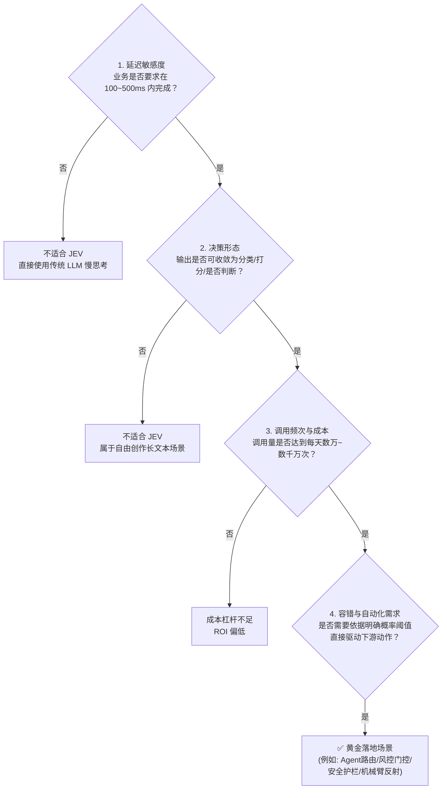
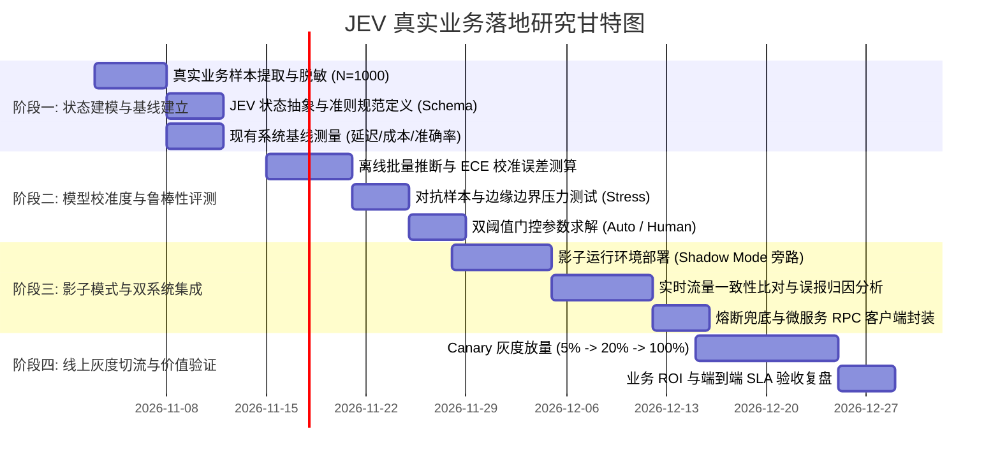

# JEV 技术真实场景落地应用研究计划书 (Project JEV-Reflex)

**项目周期**：8 周（2 个月）  
**执行角色**：AI 研究团队、系统架构团队、垂直业务线工程团队  
**核心目标**：将 JEV“系统一”决策模型无缝嵌入到高价值真实业务系统中，实现端到端响应延迟下降 70%~90%、单次决策成本降低 85%+，同时建立具备统计学可信度的置信度自动化门控机制。

---

## 一、 场景准入与立项评估（Selection Criteria）

并非所有业务都适合接入 JEV。在正式开展研究前，先通过以下**“四维准入漏斗”**锁定目标真实场景：

---

## 二、 八周四阶段研发与落地实施路线图

---

### 阶段一：真实场景状态抽象与基线建立（第 1 ~ 2 周）

#### 目标
从生产环境抽取真实数据，将非结构化上下文提炼为 JEV 的状态空间，并固化基线指标。

#### 核心任务
1. **真实数据样本集构建**：
   * 收集真实生产日志、历史工单、或传感器遥测数据共 $N \ge 1,000$ 条。
   * 包含金标准标签（Ground Truth）：业务专家的历史实际判决或最终处理结果。
   * 包含 15% 的边界模糊样本（Ambiguous Cases）和长尾异常样本。
2. **状态与准则工程设计（Schema Engineering）**：
   * 定义 `state` 的精简序列化策略（消除噪声，保留关键因果字段）。
   * 针对业务痛点定义明确的 `Choice`（互斥候选集）、`Score`（递进层级量表）、`Noul`（布尔合规性）。
3. **现有基线测量（Baseline Benchmarking）**：
   * 记录当前方案指标：平均响应耗时（P50/P99）、单位处理成本、现有规则/人工审核的准确率与漏判率。

#### 阶段产出物
* 《目标场景 JEV Schema 规范定义文档》
* 真实验证测试集：`dataset_validation_1000.jsonl`
* 现有业务基线性能对照表。

---

### 阶段二：离线决策验证与校准度（ECE）严谨评测（第 3 ~ 4 周）

#### 目标
验证 JEV 在脱机环境下的决策准确率，并严格检验其输出概率的统计学可信度。

#### 核心任务
1. **统计期望校准误差评测（Expected Calibration Error, ECE）**：
   * 将 JEV 对所有测试样本输出的预测置信度划分为 10 个区间（$[0.0, 0.1), [0.1, 0.2), \dots, [0.9, 1.0]$）。
   * 计算预测置信度与真实标签准确率的加权绝对偏差：
     $$\text{ECE} = \sum_{m=1}^{M} \frac{|B_m|}{N} \left| \text{acc}(B_m) - \text{conf}(B_m) \right|$$
   * **硬性准入标准**：$\text{ECE} \le 0.05$（证明置信度完全可用于自动化判断）。
2. **对抗样本与长尾鲁棒性测试**：
   * 注入空字段、脏数据、极端长文本及语义混淆样本，测试 JEV 的容错与概率收缩表现。
3. **自动化门控阈值数学求解**：
   * 根据业务对“假阳性（False Positive）”和“假阴性（False Negative）”的容忍度，数学推导最佳切分点：
     * **全自动执行区间**：$p \ge \theta_{\text{high}}$（如 0.94）
     * **轻量二次确认区间**：$\theta_{\text{low}} \le p < \theta_{\text{high}}$（如 0.75 ~ 0.94）
     * **人工/深度模型兜底区间**：$p < \theta_{\text{low}}$（< 0.75）

#### 阶段产出物
* 离线评测分析报告（含 ECE 校准曲线图、混淆矩阵、耗时分布）。
* 自动化阈值策略配置文件：`gating_policy.json`。

---

### 阶段三：影子模式（Shadow Run）与双系统工程化（第 5 ~ 6 周）

#### 目标
零风险接入真实生产流量，建立线上对比与工程高可用防线。

#### 核心任务
1. **旁路影子流量监听（Shadow Pipeline）**：
   * 真实请求到达微服务网关时，复制一份异步投递给 JEV。
   * JEV 实时计算决策，但**不直接影响实际业务**，仅将其结果、耗时、置信度记录进审计日志。
2. **影子结果一致性监控**：
   * 连续 7 天对比 JEV 影子决策与线上现有系统（或人工专家）的一致率。
   * 针对决策不一致的案例（Discrepancy Cases）进行专家联合归因分析：是原有系统误判，还是 JEV 准则不完善。
3. **工业级高可用与容灾机制开发**：
   * **超时熔断**：配置 Client 端超时阈值（如 500ms），超时自动回退到默认保底逻辑。
   * **双密钥自动故障转移**：集成主备 API Key 自动轮换。

#### 阶段产出物
* 影子运行 7 天对比分析看板与一致性报告（要求一致率 $\ge 96.5\%$）。
* 生产级高可用接入组件代码与容灾降级规范。

---

### 阶段四：线上灰度切流与价值复盘（第 7 ~ 8 周）

#### 目标
逐步替代旧方案，最终全量接入，量化业务与财务收益。

#### 核心任务
1. **Canary 灰度切流路线**：
   * 第 1~3 天：切入 **5%** 流量，监控报警与异常率；
   * 第 4~7 天：扩大至 **20%** 流量，验证在并发压力下的 P99 延迟稳定性；
   * 第 8~10 天：提升至 **50%**，并逐步推向 **100%**。
2. **业务与财务双重价值核算**：
   * **端到端效率**：单笔业务处理平均耗时减少绝对值。
   * **财务 ROI**：相比纯大模型或全人工审核方案，计算当月节省的 Token 费用及人力工时。
3. **长期自适应数据飞轮建立**：
   * 将 JEV 标记为低置信度（$p < \theta_{\text{low}}$）并由人工接管纠偏的数据，自动回流进入模型评估集，支持准则持续调优。

#### 阶段产出物
* 《JEV 落地实施验收复盘报告（含技术指标与 ROI 核算）》。
* 自动化持续优化流水线（Data Flywheel Pipeline）。

---

## 三、 核心验收指标（Success Criteria）

| 指标大类 | 评价指标 | 传统 LLM / 人工基准 | JEV 验收目标 | 达标判定条件 |
| :--- | :--- | :--- | :--- | :--- |
| **技术指标** | **P99 推理延迟** | 1,800 ~ 4,500 ms | $\le \mathbf{300 \sim 500\ ms}$ | 降低 80% 以上 |
| | **期望校准误差 (ECE)** | > 0.18（严重失真） | $\le \mathbf{0.05}$ | 概率具备数学真实性 |
| | **格式破损与解析失败率** | 0.8% ~ 2.0% | $\mathbf{0.00\%}$ | 强类型原生保障 |
| **业务与成本** | **每百万次决策成本** | \$500 ~ \$2,000 | $\le \mathbf{\$15 \sim \$30}$ | 成本压缩 90%+ |
| | **自动化闭环率** | 35% ~ 50% | $\ge \mathbf{85\%}$ | 高置信度自动化免审 |
| | **决策综合准确率** | 92% ~ 95% | $\ge \mathbf{97.5\%}$ | 优于或持平专家基线 |

---

## 四、 风险清单与应对策略

1. **公网网络抖动风险**：
   * *对策*：在内网边缘网关保持长连接（HTTP Keep-Alive 线程池），并在第 3 阶段建立毫秒级熔断降级策略。
2. **极端未见过模式（OOD, Out-Of-Distribution）**：
   * *对策*：JEV 在遭遇未知模式时，其置信度会自动收缩分散（`confidence` 下降）。门控逻辑捕获到低置信度后自动触发人工介入，防止盲目自动化。
3. **业务准则演进滞后**：
   * *对策*：将 `criteria` 配置外部化管理（通过远程配置中心下发），无需重新部署代码即可热更新判定描述。
