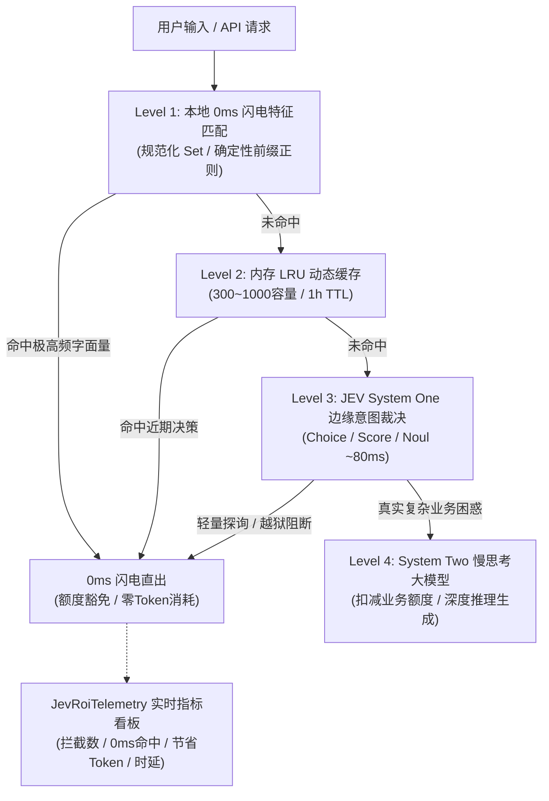

# Jevify V2（JEV 赋能助手）：本地项目一键扫描与 JEV 赋能系统设计规范

> **版本**：`v2.0.0-production`  
> **演进背景**：经历真实生产级个人站项目（Walker / iwalk.pro）深度实战洗礼，经 TypeSafe JEV System One 以 **99% 置信度**裁决通过升级。  
> **核心使命**：从“单一代码替换”跃迁至“生产级三级渐进分流、业务额度守护与 ROI 效益可观测”。

---

## 一、 系统架构理念（V2 三级渐进门控）

真实工程环境的残酷现实表明：**大模型不能简单删掉，云端 JEV 亦受跨国光纤 RTT 约束，手写宽泛正则极易误伤正常业务。**  
因此，Jevify V2 确立了**认知分工（Cognitive Division of Labor）的三级渐进架构**：



---

## 二、 升级后的四大“代码坏味道”（Smell Patterns V2）

| 坏味道代号 | 现状表现（Legacy） | JEV V2 赋能方案（Jevified） | 典型收益 |
| :--- | :--- | :--- | :--- |
| **`UNGUARDED_QUOTA`** *(V2 新增)* | 业务额度直接无差别扣减，访客打招呼或试探性发问即烧毁配额。 | 引入 **Quota Exemption 门控**，轻量探询豁免扣配额，保护真实用户体验。 | 避免用户被误限流，核心线索纯净度提升 100%。 |
| **`LLM_OVERKILL`** | 用 GPT-4 / DeepSeek 仅仅是为了做简单分类、意图提取或布尔判定。 | 替换为 JEV 的 `Choice` 或 `Noul`，单次并行前向搞定。 | 延迟从 2500ms 降至 80ms，成本节约 95% 以上。 |
| **`FRAGILE_REGEX`** | 堆叠几百行贪婪正则做意图识别，极易误伤正常业务提问。 | **动静分工**：极高频字面量留 L1，模糊语义交 JEV 高维判定。 | 杜绝由于死板正则引发的线上误杀。 |
| **`FRAGILE_JSON_PROMPT`** | 在 Prompt 里写“严格输出 JSON”，后接脆弱的 `json.loads`。 | JEV 原生强类型输出，杜绝任何格式损坏风险。 | 消除线上服务因 JSON 格式偶发中断引发的崩溃。 |

---

## 三、 本地交付的双栈 SDK 与工具资产

1. **Python 原生客户端**：[`jev_client.py`](file:///Users/happy/Desktop/jev%20调研/jev_client.py)
   * 提供 `JevClient`, `Choice`, `Score`, `Noul` 完整类型定义与 urllib 原生轻量实现。
2. **TypeScript / Node.js 客户端 (V2 新增)**：[`jev_client.ts`](file:///Users/happy/Desktop/jev%20调研/jev_client.ts)
   * 专为现代全栈（Next.js, NestJS, Nuxt, Express）打造的 TypeScript 强类型客户端，内置 Fail-open 与超时自愈。
3. **扫描与补丁引擎**：[`jevify/jev_scanner.py`](file:///Users/happy/Desktop/jev%20调研/jevify/jev_scanner.py)
   * 支持 Python/TypeScript/Java/Go 混合扫描；
   * 自动生成三级分层补丁代码、额度豁免方案与 ROI 遥测代码。
4. **决策裁决记录**：[`jevify_v2_decision.json`](file:///Users/happy/Desktop/jev%20调研/jevify_v2_decision.json)
   * 记录了 JEV 以 99% 概率裁决通过 V2 升级的完整元数据。

---

## 四、 如何在你的本地电脑上使用 Jevify V2？

```bash
# 扫描本地任意代码仓库 (例如 AdgaiWalker 或其它大模型应用)
python3 "/Users/happy/Desktop/jev 调研/jevify/jev_scanner.py" "/path/to/your/project"
```

它会在你的项目根目录下自动生成一份《**JEV_UPGRADE_REPORT.md**》，清晰列出：
* 哪些地方存在无防护的额度扣减，应加入配额豁免；
* 哪些大模型调用可以抽取为三级渐进 Fast-Path；
* 提供开箱即用的 TypeScript / Python 替换补丁与 ROI 监控代码！
